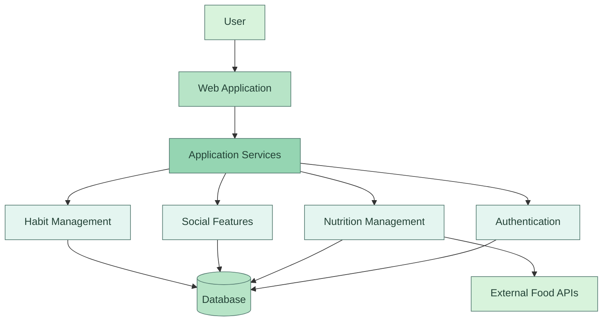
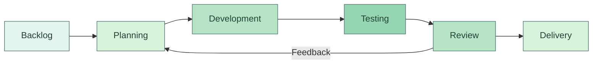

<div align="center">

# 🌿 DIMEAT

### Eat Mindfully. Build Habits. Stay Connected.

**A Hybrid Nutrition & Social Lifestyle Platform**


<br>

[About](#-about-dimeat) •
[Features](#-key-features) •
[Technologies](#-technologies) •
[Roadmap](#-project-roadmap) •
[Team](#-meet-our-team)

---

</div>

## 🌱 About DIMEAT

**DIMEAT** is a hybrid nutrition and social lifestyle platform developed as part of the Software Project Management course at Muğla Sıtkı Koçman University.

The project aims to bring nutrition tracking, daily habits, personal progress, and social interaction together within a single digital platform.

Rather than focusing solely on nutrition tracking, DIMEAT aims to create a connected and supportive experience that encourages sustainable daily habits.

> Small steps, meaningful progress, and a more connected lifestyle.

---

## ✨ Key Features

| Feature | Description |
| :--- | :--- |
| 🔐 **Authentication** | Secure account registration, login, and session management. |
| 👤 **Personal Profile** | Personalized user profiles and onboarding experience. |
| 🥗 **Nutrition Tracking** | Daily meal logging and nutritional information management. |
| 🔍 **Food Search** | Search food databases and access nutritional information. |
| 📊 **Personal Dashboard** | Visual overview of daily nutrition and personal progress. |
| 🌱 **Habit Tracking** | Create and monitor daily habits and routines. |
| 🤝 **Friendship System** | Connect with friends and manage social interactions. |
| 💬 **Direct Messaging** | Private communication between connected users. |
| 🎨 **Personalization** | Customizable language and appearance preferences. |
| 🤖 **AI Recommendations** | Planned intelligent recommendation functionality. |

---

## 💻 Technologies

<div align="center">


</div>

| Layer | Technology |
| :--- | :--- |
| Frontend | React, Next.js |
| User Interface | Tailwind CSS, Lucide Icons |
| Backend | Server-side application services |
| Database | PostgreSQL |
| External Data | USDA FoodData Central, Open Food Facts |
| Version Control | Git & GitHub |
| Project Management | Agile, Scrum & Kanban |

---

## 🏗️ System Architecture



The platform follows a modular architecture designed to support maintainability, scalability, data privacy, and future feature integration.

---

## 📈 Development Status

| Module | Current Status |
| :--- | :--- |
| Authentication | 🟣 Review & Testing |
| Database Management | 🟣 Review & Testing |
| Nutrition Tracking | 🟣 Review & Testing |
| Food Search | 🟣 Review & Testing |
| Personal Dashboard | 🟣 Review & Testing |
| Habit Tracking | 🟡 In Development |
| Personalization | 🟡 In Development |
| Friendship System | 🟡 In Development |
| Direct Messaging | 🟡 In Development |
| AI Recommendations | ⚪ Planned |
| Social Feed | ⚪ Planned |
| Quality Assurance | 🟡 In Progress |

> Implementation status does not necessarily indicate completed acceptance testing. Features remain subject to integration, verification, and team approval.

---

## 🗓️ Project Roadmap

| Milestone | Description | Status |
| :---: | :--- | :---: |
| **M0** | Project Selection & Team Organization | 🟢 Completed |
| **M1** | Project Initiation | 🟢 Completed |
| **M2** | Project Plan & Baseline | 🟢 Completed |
| **M3** | Midterm Project Review | 🟢 Report Prepared |
| **M4** | Change, Quality & Progress Management | 🟡 In Progress |
| **M5** | Final Demonstration & Project Closure | ⚪ Upcoming |

---

## 📋 Project Management

DIMEAT follows an Agile project management approach combining iterative development, continuous improvement, and collaborative task management.

### Our Development Workflow



### Project Resources

| Resource | Description |
| :--- | :--- |
| 📌 [Project Board](PROJECT_BOARD.md) | Task management and progress tracking |
| 📄 [Weekly Reports](docs/weekly-reports) | Weekly activities and development progress |
| 🐛 [GitHub Issues](../../issues) | Task tracking and issue management |
| 🔀 [Pull Requests](../../pulls) | Code review and integration |
| 📝 [Commit History](../../commits) | Development history and contributions |

---

## 🚀 Getting Started

### Prerequisites

- Node.js 20.9 or higher
- pnpm
- Git
- Configured environment variables

### Installation

Clone the repository:

```bash
git clone https://github.com/se-230717032/dimeat-project.git
```

Navigate to the project directory:

```bash
cd dimeat-project
```

Install dependencies:

```bash
pnpm install --frozen-lockfile
```

Create the local environment configuration:

```bash
cp .env.example .env.local
```

Configure the required environment variables and database migrations before starting the application.

Run the development server:

```bash
pnpm dev
```

Open the application:

**http://localhost:3000**

---

## 🧪 Quality Assurance

Quality assurance is an essential part of the DIMEAT development lifecycle.

Our verification process focuses on:

- Functional testing
- Input validation
- Authentication and authorization
- Database integrity
- User experience
- Error handling
- Integration testing
- Regression testing

### Validation Commands

```bash
pnpm build
pnpm typecheck
pnpm lint
```

Test results and acceptance evidence are documented throughout the development process.

---

## 📂 Repository Structure

```text
dimeat-project/
│
├── src/
│   └── Application source code
│
├── docs/
│   └── weekly-reports/
│
├── PROJECT_BOARD.md
├── README.md
├── package.json
└── .env.example
```

---

## 👥 Meet Our Team

<div align="center">

### DIMEAT DEVS

*Four minds. One vision.*

</div>

| Team Member | Role | Responsibilities |
| :--- | :--- | :--- |
| **Cemre Alkış** | Project Manager & System Analyst | Project planning, requirements, coordination |
| **Ebru Sena Ünsal** | Technical Lead & Backend Developer | Architecture, backend development, integration |
| **Harun Arslan** | QA & Test Lead | Software testing, quality assurance, development |
| **Aysima Tatlı** | Documentation Lead & Agile Administrator | Documentation, Agile processes, version management |

---

## 🎓 Academic Information

| | |
| :--- | :--- |
| **University** | Muğla Sıtkı Koçman University |
| **Department** | Software Engineering |
| **Course** | Software Project Management |
| **Academic Year** | 2026–2027 |
| **Project Team** | Dimeat Devs |
| **Methodology** | Agile Project Management |

---

## 🔮 Future Improvements

- AI-powered personalized recommendations
- Expanded social community features
- Advanced progress visualization
- Enhanced accessibility
- Performance optimization
- Comprehensive acceptance testing

---

## 💚 Our Vision

DIMEAT aims to create an accessible, supportive, and connected digital experience where users can develop sustainable habits and manage their daily routines.

DIMEAT is an academic software project and does not provide medical diagnosis or treatment.

---

<div align="center">

### 🌿 DIMEAT

**More than tracking. A connected lifestyle.**

<br>

Developed by **Dimeat Devs**

Muğla Sıtkı Koçman University  
Department of Software Engineering

© 2026 DIMEAT Project


</div>
