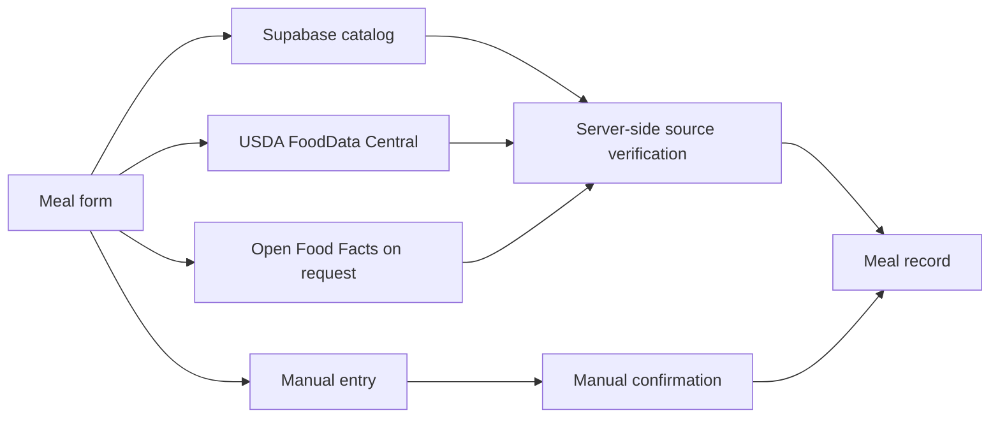

<div align="center">
🌿 DIMEAT
Nutrition & Social Lifestyle Platform
Muğla Sıtkı Koçman University · Software Project Management


Overview · Getting Started · Supabase Setup · Project Roadmap · Team
</div>
---
📖 Overview
DIMEAT is a nutrition and social lifestyle application developed for the Software Project Management course at Muğla Sıtkı Koçman University (MSKU).
Feature overview
Feature	Description	Status
Authentication	Email/password registration, sign-in and sign-out	Available
Private profile	User-specific profile and onboarding	Available
Dashboard	Daily calorie and macronutrient totals	Available
Meal diary	Manual or source-based nutrition calculations	Available
Community	Social interaction pages	In development
Messaging	Messaging pages	In development
Habits	Habit tracking pages	In development
> Feature status reflects the original README, not an independent acceptance-test assessment.
🛠 Technology Stack
Layer	Technology
Web framework	Next.js App Router
User interface	React
Styling	Tailwind CSS
Icons	Lucide
🚀 Getting Started
Install Node.js 20.9 or later and pnpm. From the project root, run:
```bash
pnpm install --frozen-lockfile
cp .env.example .env.local
pnpm dev
```
The copy command also works in Windows PowerShell. Open http://localhost:3000.
Without Supabase configuration, the sign-in and registration pages display a setup warning. Application pages require an authenticated session.
🗄 Supabase Setup
Create a project in the Supabase Dashboard. Add the Project URL and anon/public key (or publishable key) to `.env.local`:
```env
NEXT_PUBLIC_SUPABASE_URL=https://YOUR_PROJECT.supabase.co
NEXT_PUBLIC_SUPABASE_ANON_KEY=YOUR_PUBLIC_KEY
```
These two values are public and can be used on the client. `NEXT_PUBLIC_SUPABASE_ANON_KEY` accepts either the legacy anon key or the new publishable key.
> [!IMPORTANT]
> Never place service role keys or other secrets in `NEXT_PUBLIC_` variables. `.env.local` is ignored by Git.
Client creation functions are located in `src/lib/supabase/client.ts` and `src/lib/supabase/server.ts`. Next.js `proxy.ts` refreshes session cookies, while server layouts verify users through `getUser()`.
Database migrations
Apply migrations in the following order:
Order	Migration	Purpose
1	`20261029000100_profiles.sql`	User profiles and onboarding
2	`20261110000100_meal_entries.sql`	User-specific meal records
3	`20261116000100_foods_and_nutrition.sql`	Read-only food catalog and meal source information; preserves existing meal records
4	`20261116000200_food_catalog_seed_repair.sql`	Adds missing verified USDA entries for eggs, boiled eggs, bananas, rice and pasta without modifying existing food or meal rows
The final migration adds verified per-100 g values from USDA FoodData Central and unit-to-gram equivalents where available. Authenticated users can read the `foods` table, but application users cannot write to the catalog.
Using the Supabase CLI from the project root:
```bash
npx supabase login
npx supabase link --project-ref YOUR_PROJECT_REF
npx supabase db push
```
Replace `YOUR_PROJECT_REF` with the project identifier from the Dashboard. Alternatively, run each complete migration file in the Supabase SQL Editor in order. Apply the migrations before testing user registration.
Authentication and email verification
Authentication uses email and password. Enable the provider under Authentication → Providers → Email in the Supabase Dashboard.
The default Confirm signup template is supported: registration redirects to `/auth/callback`, which exchanges the verification code for a session. The `/auth/confirm` route is also retained for custom token-hash templates.
Under Authentication → URL Configuration, configure:
Setting	Local value
Site URL	`http://localhost:3000`
Allowed redirects	`http://localhost:3000/**`
Source-based food search
The meal form automatically searches the Supabase `foods` catalog and USDA as the user types. Users can repeat a USDA search or explicitly search packaged products through Open Food Facts. Manual entry remains available if an external service fails.

Automatic values are scaled from the source's per-100 g data. When saving, the server reads the source again and recalculates the values. Calculations are not performed for units or portions without source data or gram equivalents. Saving without selecting a food first displays a warning and requires separate confirmation for manual entry.
USDA FoodData Central
USDA searches use the limited `DEMO_KEY` by default. For regular use, obtain a FoodData Central API key and add the server-only `USDA_API_KEY` to `.env.local`. Do not expose it through a `NEXT_PUBLIC_` variable.
Open Food Facts
Open Food Facts requires a custom User-Agent identifying the application. To enable packaged-product search, add `OPEN_FOOD_FACTS_CONTACT_EMAIL` to `.env.local` and restart the server. API requests occur only when the user presses the search button. The server uses per-minute rate limiting and short-lived caching.
Data source	License	Attribution and usage
USDA FoodData Central	CC0	Source name and FDC link displayed
Open Food Facts	ODbL	Attribution link displayed on results and saved source-based meals
Open Food Facts products are not copied into the shared `foods` catalog. Any future bulk redistribution feature must separately satisfy ODbL sharing requirements. Open Food Facts data is community-contributed and its accuracy is not guaranteed. Calculations from both sources are estimates.
🧪 Quality Checks
```bash
pnpm build
pnpm typecheck
pnpm lint
```
The `/home` and `/diary` routes read the same meal records. Onboarding data is saved in the user's private profile row. DIMEAT does not provide medical diagnosis or treatment.
📋 Project Roadmap
The repository maintains weekly project reports.
Milestone	Deliverable	Status
M0	Project selection and team organization	✅ Completed
M1	Project initiation, stakeholders and success criteria	✅ Completed
M2	Backlog, schedule, responsibilities and risks	✅ Completed
M3	Midterm product and plan review	⬜ Unchecked
M4	Change, quality and progress tracking	⬜ Unchecked
M5	Final demonstration and closure report	⬜ Unchecked
> Milestone checkmarks are preserved from the supplied README.
👥 Team
Team member	Student ID	Responsibility
Cemre Alkış	230717008	Project management and development
Ebru Sena Ünsal	230717032	Technical leadership and development
Harun Arslan	220717604	Quality, testing and development
Aysima Tatlı	230717043	Documentation and version management
📁 Repository Structure
```text
dimeat/
├── src/                    # Next.js application and server operations
├── supabase/
│   └── migrations/         # Database schema and food catalog migrations
└── docs/
    └── weekly-reports/     # Existing project reports
```
---
<div align="center">
DIMEAT · MSKU Software Project Management
</div>
